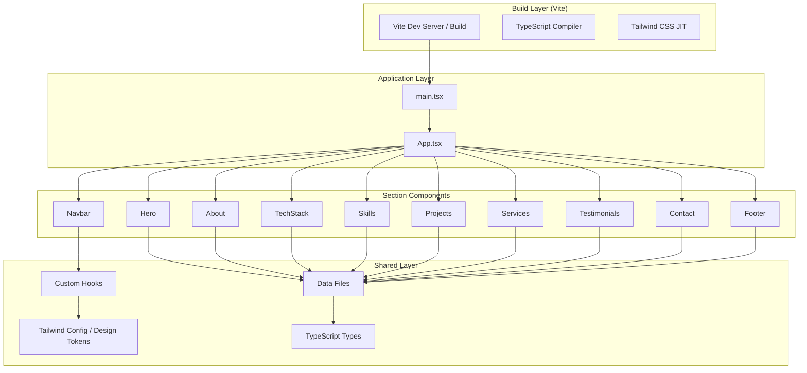
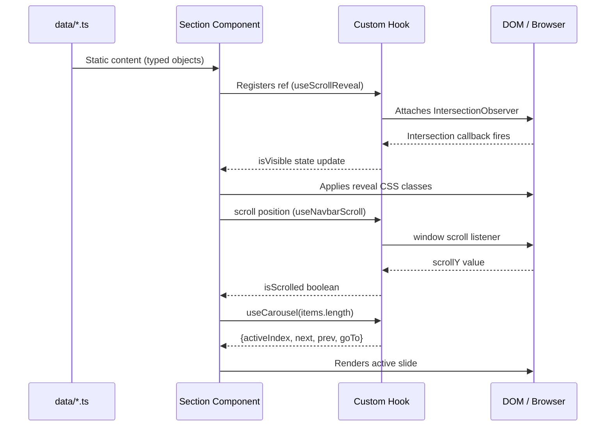

# Design Document: Developer Portfolio

## Overview

A premium dark-themed developer portfolio built with React 18, TypeScript, Vite, and Tailwind CSS. The design centers on an almost-black palette with neon-green accents, glassmorphism surfaces, and restrained animations — projecting professionalism and technical credibility. All personal content lives in data/config files so the portfolio owner can update it without touching component code.

The application is a fully client-side single-page application (SPA) with no routing library required. It uses the browser's Intersection Observer API for scroll-reveal animations, native CSS transitions for hover states, and a custom carousel hook for the Projects and Testimonials sections. The contact form is visually complete but requires a backend service or third-party provider (e.g., Formspree, EmailJS) for actual message delivery.

The architecture follows a strict component/data separation pattern: components own visual logic, data files own content, and a shared Tailwind design token config owns all styling constants. This makes the portfolio trivially customizable without requiring knowledge of React.

---

## Architecture

### High-Level System Diagram



### Component Tree

```mermaid
graph TD
    APP[App.tsx]

    APP --> NAV[Navbar]
    NAV --> NAVLINKS[NavLinks]
    NAV --> HIREME[HireMeButton]
    NAV --> HAMBURGER[HamburgerMenu]
    NAV --> MOBILEMENU[MobileMenu]

    APP --> HERO[Hero]
    HERO --> BADGE[StatusBadge]
    HERO --> CTABTNS[CTAButtons]
    HERO --> STATSROW[StatsRow]
    HERO --> PORTRAIT[DeveloperPortrait]

    APP --> ABOUT[About]
    ABOUT --> BIO[Biography]
    ABOUT --> RESUMEBTN[ResumeButton]
    ABOUT --> BENTOCARDS[BentoCards]

    APP --> TECH[TechStack]
    TECH --> TECHCARD[TechCard]

    APP --> SKILLS[Skills]
    SKILLS --> SKILLCOL[SkillColumn]
    SKILLCOL --> SKILLENTRY[SkillEntry]
    SKILLENTRY --> PROGRESSBAR[ProgressBar]

    APP --> PROJECTS[Projects]
    PROJECTS --> CATFILTER[CategoryFilter]
    PROJECTS --> CAROUSEL[Carousel]
    CAROUSEL --> PROJECTCARD[ProjectCard]

    APP --> SERVICES[Services]
    SERVICES --> SERVICECARD[ServiceCard]

    APP --> TESTIMONIALS[Testimonials / Approach]
    TESTIMONIALS --> CAROUSELB[Carousel]
    CAROUSELB --> APPROACHCARD[ApproachCard]

    APP --> CONTACT[Contact]
    CONTACT --> CONTACTFORM[ContactForm]
    CONTACT --> CONTACTINFO[ContactInfoCards]

    APP --> FOOTER[Footer]
    FOOTER --> FOOTERCOL[FooterColumn]
    FOOTER --> SOCIALLINKS[SocialLinks]
```



### Data Flow Diagram



---

## File & Directory Structure

```
portfolio/
├── index.html
├── vite.config.ts
├── tailwind.config.ts
├── postcss.config.js
├── tsconfig.json
├── package.json
│
├── public/
│   ├── favicon.ico
│   └── assets/
│       └── portrait-placeholder.webp
│
└── src/
    ├── main.tsx
    ├── App.tsx
    ├── index.css               ← global styles, font imports, CSS custom props
    │
    ├── types/
    │   └── index.ts            ← all shared TypeScript interfaces & types
    │
    ├── data/
    │   ├── personal.ts         ← name, bio, contact, social links
    │   ├── techStack.ts        ← tech stack items
    │   ├── skills.ts           ← skills by category
    │   ├── projects.ts         ← project entries
    │   ├── services.ts         ← service offerings
    │   └── approach.ts         ← development approach / testimonial entries
    │
    ├── hooks/
    │   ├── useScrollReveal.ts
    │   ├── useNavbarScroll.ts
    │   ├── useCarousel.ts
    │   └── useMediaQuery.ts
    │
    └── components/
        ├── Navbar/
        │   ├── Navbar.tsx
        │   └── MobileMenu.tsx
        ├── Hero/
        │   └── Hero.tsx
        ├── About/
        │   └── About.tsx
        ├── TechStack/
        │   └── TechStack.tsx
        ├── Skills/
        │   └── Skills.tsx
        ├── Projects/
        │   └── Projects.tsx
        ├── Services/
        │   └── Services.tsx
        ├── Testimonials/
        │   └── Testimonials.tsx
        ├── Contact/
        │   └── Contact.tsx
        ├── Footer/
        │   └── Footer.tsx
        └── ui/
            ├── GlassCard.tsx
            ├── GreenBadge.tsx
            ├── ProgressBar.tsx
            ├── Carousel.tsx
            └── SectionWrapper.tsx
```

---

## Tailwind Configuration & Design Tokens

The `tailwind.config.ts` is the single source of truth for all design tokens.

```typescript
// tailwind.config.ts
import type { Config } from 'tailwindcss'

const config: Config = {
  content: ['./index.html', './src/**/*.{ts,tsx}'],
  theme: {
    extend: {
      colors: {
        // Backgrounds
        'bg-primary':   '#050605',
        'bg-secondary': '#0A0C0A',
        'bg-card':      '#111411',
        'bg-elevated':  '#151A15',

        // Accents
        'green-primary':   '#7CFF6B',
        'green-secondary': '#4ADE80',

        // Text
        'text-primary':   '#F5F7F4',
        'text-secondary': '#A1A8A0',
        'text-muted':     '#707770',

        // Borders
        'border-subtle': 'rgba(255, 255, 255, 0.10)',
        'border-green':  'rgba(124, 255, 107, 0.25)',
      },

      fontFamily: {
        heading: ['"Space Grotesk"', 'sans-serif'],
        body:    ['"Inter"',         'sans-serif'],
      },

      fontSize: {
        'hero':    ['clamp(56px, 6vw, 72px)', { lineHeight: '1.05' }],
        'section': ['clamp(40px, 4vw, 48px)', { lineHeight: '1.1'  }],
        'card':    ['clamp(18px, 2vw, 24px)', { lineHeight: '1.3'  }],
        'body-lg': ['18px', { lineHeight: '1.7' }],
        'body':    ['16px', { lineHeight: '1.7' }],
        'body-sm': ['15px', { lineHeight: '1.7' }],
        'label':   ['13px', { lineHeight: '1.4', letterSpacing: '0.05em' }],
      },

      borderRadius: {
        'glass': '16px',
        'glass-lg': '24px',
      },

      backdropBlur: {
        'glass': '12px',
      },

      boxShadow: {
        'glass':       '0 4px 24px rgba(0, 0, 0, 0.4)',
        'green-glow':  '0 0 24px rgba(124, 255, 107, 0.15)',
        'green-glow-lg': '0 0 48px rgba(124, 255, 107, 0.20)',
        'card-hover':  '0 8px 32px rgba(0, 0, 0, 0.6), 0 0 16px rgba(124, 255, 107, 0.10)',
      },

      animation: {
        'fade-up':    'fadeUp 0.4s ease forwards',
        'fade-in':    'fadeIn 0.3s ease forwards',
        'pulse-slow': 'pulse 4s cubic-bezier(0.4, 0, 0.6, 1) infinite',
      },

      keyframes: {
        fadeUp: {
          '0%':   { opacity: '0', transform: 'translateY(16px)' },
          '100%': { opacity: '1', transform: 'translateY(0)'    },
        },
        fadeIn: {
          '0%':   { opacity: '0' },
          '100%': { opacity: '1' },
        },
      },

      transitionDuration: {
        '250': '250ms',
      },
    },
  },
  plugins: [],
}

export default config
```

### Global CSS (`src/index.css`)

```css
@import url('https://fonts.googleapis.com/css2?family=Space+Grotesk:wght@400;500;600;700&family=Inter:wght@400;500;600&display=swap');

@tailwind base;
@tailwind components;
@tailwind utilities;

@layer base {
  :root {
    color-scheme: dark;
  }

  html {
    scroll-behavior: smooth;
  }

  body {
    @apply bg-bg-primary text-text-primary font-body antialiased;
  }

  /* Reduced motion support */
  @media (prefers-reduced-motion: reduce) {
    *, *::before, *::after {
      animation-duration: 0.01ms !important;
      animation-iteration-count: 1 !important;
      transition-duration: 0.01ms !important;
    }

    html {
      scroll-behavior: auto;
    }
  }
}

@layer utilities {
  /* Glassmorphism utility class */
  .glass {
    background: rgba(17, 20, 17, 0.60);
    backdrop-filter: blur(12px);
    -webkit-backdrop-filter: blur(12px);
    border: 1px solid rgba(255, 255, 255, 0.08);
    border-radius: 16px;
  }

  .glass-elevated {
    background: rgba(21, 26, 21, 0.70);
    backdrop-filter: blur(16px);
    -webkit-backdrop-filter: blur(16px);
    border: 1px solid rgba(124, 255, 107, 0.12);
    border-radius: 16px;
  }

  /* Ambient glow blob */
  .ambient-glow {
    position: absolute;
    border-radius: 50%;
    background: radial-gradient(circle, rgba(124, 255, 107, 0.08) 0%, transparent 70%);
    filter: blur(40px);
    pointer-events: none;
  }

  /* Scroll-reveal initial state */
  .reveal {
    opacity: 0;
    transform: translateY(16px);
    transition: opacity 0.35s ease, transform 0.35s ease;
  }

  .reveal.visible {
    opacity: 1;
    transform: translateY(0);
  }

  /* Staggered reveal delays */
  .reveal-delay-1 { transition-delay: 100ms; }
  .reveal-delay-2 { transition-delay: 200ms; }
  .reveal-delay-3 { transition-delay: 300ms; }
  .reveal-delay-4 { transition-delay: 400ms; }

  /* Focus ring — visible for keyboard nav */
  .focus-ring:focus-visible {
    outline: 2px solid #7CFF6B;
    outline-offset: 3px;
    border-radius: 4px;
  }
}
```

---

## Components and Interfaces

### Shared UI Primitives

#### `GlassCard`

```typescript
interface GlassCardProps {
  /** Apply elevated border (green tint) instead of subtle white */
  elevated?: boolean
  /** Additional Tailwind classes */
  className?: string
  children: React.ReactNode
  /** Forwarded ref for scroll-reveal targeting */
  ref?: React.Ref<HTMLDivElement>
}
```

#### `SectionWrapper`

```typescript
interface SectionWrapperProps {
  id: string
  /** Tailwind class for top/bottom padding override */
  className?: string
  children: React.ReactNode
}
```

Renders `<section id={id}>` with standard vertical padding (`py-24 md:py-32`) and `max-w-7xl mx-auto px-6` inner container.

#### `ProgressBar`

```typescript
interface ProgressBarProps {
  /** 0–100 */
  value: number
  /** Accessible label for screen readers */
  label: string
  /** Animate fill on mount */
  animate?: boolean
}
```

Renders `<div role="progressbar" aria-valuenow={value} aria-valuemin={0} aria-valuemax={100} aria-label={label}>`.

#### `Carousel`

```typescript
interface CarouselProps<T> {
  items: T[]
  renderItem: (item: T, index: number) => React.ReactNode
  /** Auto-advance interval in ms; 0 = disabled */
  autoPlayInterval?: number
  className?: string
}
```

---

### Section Component Interfaces

#### `Navbar`

```typescript
// No external props — reads scroll state internally via useNavbarScroll
// Internal state: isMobileMenuOpen: boolean
```

**Behavior**:
- Transparent (`bg-transparent`) when `scrollY === 0`
- Glassmorphism (`glass` utility class, `shadow-glass`) when `scrollY > 60`
- Transition: `transition-all duration-300`
- Mobile menu slides down from top with `transition-transform`
- Hamburger button: `aria-label="Open menu"` / `aria-label="Close menu"`, `aria-expanded`

#### `Hero`

```typescript
interface HeroProps {
  data: PersonalData   // from data/personal.ts
}
```

Two-column layout: `grid grid-cols-1 lg:grid-cols-2 gap-12 items-center`.
- Left col: badge → `<h1>` → description → CTA buttons → stats row
- Right col: portrait container with green radial glow pseudo-element

#### `About`

```typescript
interface AboutProps {
  data: PersonalData
}
```

Two-column layout on `lg:`. Right column uses a 2×2 bento grid of `GlassCard` components.

#### `TechStack`

```typescript
interface TechStackProps {
  items: TechItem[]
}
```

Responsive grid: `grid grid-cols-3 sm:grid-cols-4 md:grid-cols-6 lg:grid-cols-8 gap-4`.

#### `Skills`

```typescript
interface SkillsProps {
  categories: SkillCategory[]
}
```

Three-column layout `grid grid-cols-1 md:grid-cols-3 gap-8`. Each column is a `GlassCard` containing a list of `SkillEntry` components.

#### `Projects`

```typescript
interface ProjectsProps {
  projects: Project[]
}
```

Renders category filter buttons above a `Carousel`. Filter updates a `filteredProjects` derived state. Carousel uses `useCarousel(filteredProjects.length)`.

#### `Services`

```typescript
interface ServicesProps {
  services: Service[]
}
```

Centered heading + bento-style grid with CSS grid-pattern background overlay. Grid: `grid grid-cols-1 sm:grid-cols-2 lg:grid-cols-3 gap-6`.

#### `Testimonials`

```typescript
interface TestimonialsProps {
  entries: ApproachEntry[]
}
```

Carousel of `ApproachCard` components. Section title defaults to "What You Can Expect".

#### `Contact`

```typescript
interface ContactProps {
  data: PersonalData
}
```

Two-column `lg:grid-cols-5`: form col (`lg:col-span-3`) + info col (`lg:col-span-2`). Form manages its own state with `useState`. Validation runs on submit.

#### `Footer`

```typescript
interface FooterProps {
  data: PersonalData
  services: Service[]
}
```

---

## Data Models

### `src/types/index.ts`

```typescript
// ─── Personal / Contact ──────────────────────────────────────────────────────

export interface SocialLink {
  platform: 'github' | 'linkedin' | 'twitter' | 'email' | string
  url: string
  /** Icon component or name key */
  icon: string
}

export interface Stat {
  value: string      // e.g. "3+"
  label: string      // e.g. "Years Experience"
}

export interface PersonalData {
  name: string
  title: string
  tagline: string
  bio: string[]            // paragraphs
  resumeUrl: string        // path or external URL
  portraitSrc: string
  email: string
  location: string
  socials: SocialLink[]
  stats: Stat[]
}

// ─── Tech Stack ───────────────────────────────────────────────────────────────

export interface TechItem {
  name: string
  /** SVG icon key or src path */
  icon: string
  /** Color used for icon accent (optional) */
  color?: string
}

// ─── Skills ───────────────────────────────────────────────────────────────────

export type ProficiencyLabel = 'Beginner' | 'Intermediate' | 'Advanced' | 'Expert'

export interface SkillEntry {
  icon: string
  name: string
  proficiency: ProficiencyLabel
  /** 0–100 */
  level: number
}

export interface SkillCategory {
  title: string
  skills: SkillEntry[]
}

// ─── Projects ─────────────────────────────────────────────────────────────────

export interface Project {
  id: string
  title: string
  description: string
  /** URL path or external link */
  imageSrc: string
  tags: string[]
  /** Comma-separated category labels for filter */
  categories: string[]
  liveUrl?: string
  githubUrl?: string
  featured?: boolean
}

// ─── Services ─────────────────────────────────────────────────────────────────

export interface Service {
  icon: string
  title: string
  description: string
}

// ─── Approach / Testimonials ──────────────────────────────────────────────────

export interface ApproachEntry {
  icon: string
  heading: string
  body: string
}

// ─── Contact Form ─────────────────────────────────────────────────────────────

export interface ContactFormData {
  name: string
  email: string
  subject: string
  message: string
}

export interface ContactFormErrors {
  name?: string
  email?: string
  subject?: string
  message?: string
}

export type FormStatus = 'idle' | 'submitting' | 'success' | 'error'
```

---

## Custom Hook Signatures

### `useNavbarScroll`

```typescript
/**
 * Tracks whether the page has scrolled past the threshold.
 * Used by Navbar to toggle between transparent and glassmorphism styles.
 */
function useNavbarScroll(threshold?: number): boolean

// threshold default: 60 (px)
// Returns: isScrolled — true when window.scrollY > threshold

// Preconditions:
//   - Called inside a React component or hook
//   - window is defined (browser environment)
// Postconditions:
//   - Listener is cleaned up on unmount
//   - Returns stable boolean reference
```

**Implementation sketch**:
```typescript
export function useNavbarScroll(threshold = 60): boolean {
  const [isScrolled, setIsScrolled] = useState(false)

  useEffect(() => {
    const handler = () => setIsScrolled(window.scrollY > threshold)
    window.addEventListener('scroll', handler, { passive: true })
    return () => window.removeEventListener('scroll', handler)
  }, [threshold])

  return isScrolled
}
```

---

### `useScrollReveal`

```typescript
/**
 * Attaches an IntersectionObserver to a container ref.
 * Adds/removes 'visible' CSS class to child elements with class 'reveal'.
 * Respects prefers-reduced-motion.
 */
function useScrollReveal<T extends HTMLElement>(
  options?: IntersectionObserverInit
): React.RefObject<T>

// Default options: { threshold: 0.15, rootMargin: '0px 0px -48px 0px' }
// Preconditions:
//   - Called inside a React component
// Postconditions:
//   - Each child element with class 'reveal' is observed
//   - When intersecting: 'visible' class added
//   - Observer disconnected on unmount

// Reduced-motion: when prefers-reduced-motion is set,
//   all 'reveal' elements are made immediately visible (no animation)
```

**Implementation sketch**:
```typescript
export function useScrollReveal<T extends HTMLElement>(
  options: IntersectionObserverInit = {}
): React.RefObject<T> {
  const ref = useRef<T>(null)
  const prefersReducedMotion = useMediaQuery('(prefers-reduced-motion: reduce)')

  useEffect(() => {
    const container = ref.current
    if (!container) return

    const targets = Array.from(container.querySelectorAll<HTMLElement>('.reveal'))

    if (prefersReducedMotion) {
      targets.forEach(el => el.classList.add('visible'))
      return
    }

    const observer = new IntersectionObserver((entries) => {
      entries.forEach(entry => {
        if (entry.isIntersecting) {
          entry.target.classList.add('visible')
          observer.unobserve(entry.target)  // fire once
        }
      })
    }, { threshold: 0.15, rootMargin: '0px 0px -48px 0px', ...options })

    targets.forEach(el => observer.observe(el))
    return () => observer.disconnect()
  }, [prefersReducedMotion])

  return ref
}
```

---

### `useCarousel`

```typescript
/**
 * Manages carousel index state and navigation actions.
 * Supports optional auto-play with pause-on-hover.
 */
function useCarousel(
  itemCount: number,
  autoPlayInterval?: number
): {
  activeIndex: number
  next: () => void
  prev: () => void
  goTo: (index: number) => void
  pauseAutoPlay: () => void
  resumeAutoPlay: () => void
}

// Preconditions:
//   - itemCount >= 1
// Postconditions:
//   - activeIndex always in range [0, itemCount - 1]
//   - next() wraps from last → first
//   - prev() wraps from first → last
//   - goTo(i) clamps i to valid range
//   - autoPlay interval cleared on unmount
```

**Loop invariant**: `0 <= activeIndex < itemCount` at all times.

**Implementation sketch**:
```typescript
export function useCarousel(itemCount: number, autoPlayInterval = 0) {
  const [activeIndex, setActiveIndex] = useState(0)
  const [isPaused, setIsPaused]       = useState(false)
  const intervalRef = useRef<ReturnType<typeof setInterval> | null>(null)

  const next = useCallback(() => {
    setActiveIndex(i => (i + 1) % itemCount)
  }, [itemCount])

  const prev = useCallback(() => {
    setActiveIndex(i => (i - 1 + itemCount) % itemCount)
  }, [itemCount])

  const goTo = useCallback((index: number) => {
    setActiveIndex(Math.max(0, Math.min(index, itemCount - 1)))
  }, [itemCount])

  useEffect(() => {
    if (autoPlayInterval <= 0 || isPaused) return
    intervalRef.current = setInterval(next, autoPlayInterval)
    return () => {
      if (intervalRef.current) clearInterval(intervalRef.current)
    }
  }, [autoPlayInterval, isPaused, next])

  return {
    activeIndex,
    next,
    prev,
    goTo,
    pauseAutoPlay:  () => setIsPaused(true),
    resumeAutoPlay: () => setIsPaused(false),
  }
}
```

---

### `useMediaQuery`

```typescript
/**
 * Subscribes to a CSS media query and returns its current match state.
 */
function useMediaQuery(query: string): boolean

// Preconditions:
//   - query is a valid CSS media query string
// Postconditions:
//   - Returns true when the media query matches
//   - Cleans up listener on unmount or query change
```

---

## Key Algorithm Patterns

### Carousel Slide Rendering

The `Carousel` UI component uses CSS transforms for slide transitions, avoiding reflows. Only the active slide and its immediate neighbors are rendered (windowed rendering for large item lists).

```typescript
// Carousel.tsx — render logic
function Carousel<T>({ items, renderItem, autoPlayInterval = 0 }: CarouselProps<T>) {
  const { activeIndex, next, prev, goTo, pauseAutoPlay, resumeAutoPlay } =
    useCarousel(items.length, autoPlayInterval)

  return (
    <div
      className="relative overflow-hidden"
      onMouseEnter={pauseAutoPlay}
      onMouseLeave={resumeAutoPlay}
    >
      {/* Slide track */}
      <div
        className="flex transition-transform duration-300 ease-in-out"
        style={{ transform: `translateX(-${activeIndex * 100}%)` }}
        // LOOP INVARIANT: translateX offset equals activeIndex * 100%
      >
        {items.map((item, i) => (
          <div key={i} className="min-w-full" aria-hidden={i !== activeIndex}>
            {renderItem(item, i)}
          </div>
        ))}
      </div>

      {/* Controls */}
      <button onClick={prev} aria-label="Previous slide" className="focus-ring ...">
        {/* chevron left icon */}
      </button>
      <button onClick={next} aria-label="Next slide" className="focus-ring ...">
        {/* chevron right icon */}
      </button>

      {/* Dot indicators */}
      <div role="tablist" aria-label="Slide navigation">
        {items.map((_, i) => (
          <button
            key={i}
            role="tab"
            aria-selected={i === activeIndex}
            aria-label={`Go to slide ${i + 1}`}
            onClick={() => goTo(i)}
            className="focus-ring ..."
          />
        ))}
      </div>
    </div>
  )
}
```

### Project Category Filter

```typescript
// Projects.tsx — filter algorithm
// Precondition:  projects is a non-empty array; activeCategory is 'All' or a valid category string
// Postcondition: filteredProjects contains only items whose categories array includes activeCategory
//                (or all items when activeCategory === 'All')
// Loop invariant: every item in filteredProjects satisfies the category predicate

const [activeCategory, setActiveCategory] = useState<string>('All')

const categories = useMemo((): string[] => {
  const cats = new Set<string>(['All'])
  projects.forEach(p => p.categories.forEach(c => cats.add(c)))
  return Array.from(cats)
}, [projects])

const filteredProjects = useMemo((): Project[] => {
  if (activeCategory === 'All') return projects
  return projects.filter(p => p.categories.includes(activeCategory))
}, [projects, activeCategory])

// When activeCategory changes, carousel resets to index 0
const carousel = useCarousel(filteredProjects.length)
useEffect(() => { carousel.goTo(0) }, [activeCategory])
```

### Contact Form Validation

```typescript
// Contact.tsx — validation algorithm
// Precondition:  formData fields are strings (possibly empty)
// Postcondition: returns ContactFormErrors; object is empty iff all fields are valid

function validateForm(data: ContactFormData): ContactFormErrors {
  const errors: ContactFormErrors = {}

  if (!data.name.trim()) {
    errors.name = 'Name is required'
  }

  const emailPattern = /^[^\s@]+@[^\s@]+\.[^\s@]+$/
  if (!data.email.trim()) {
    errors.email = 'Email is required'
  } else if (!emailPattern.test(data.email)) {
    errors.email = 'Please enter a valid email address'
  }

  if (!data.subject.trim()) {
    errors.subject = 'Subject is required'
  }

  if (!data.message.trim()) {
    errors.message = 'Message is required'
  } else if (data.message.trim().length < 20) {
    errors.message = 'Message must be at least 20 characters'
  }

  return errors
}
```

Form submission state machine:

```
idle → (submit) → submitting → (success) → success
                              → (error)   → error
error/success → (reset/retry) → idle
```

### Scroll-Reveal Stagger Pattern

Sections that contain multiple cards apply `reveal reveal-delay-N` classes to individual cards, creating a staggered entrance effect without JavaScript timers:

```typescript
// Usage pattern in any section with card grid
<div ref={sectionRef}>
  {items.map((item, i) => (
    <div
      key={item.id}
      className={`reveal reveal-delay-${(i % 4) + 1}`}
    >
      <GlassCard>{/* ... */}</GlassCard>
    </div>
  ))}
</div>
```

The modulo 4 keeps delay cycling through `100ms → 400ms` and prevents excessive delays for long lists.

---

## Error Handling

### Contact Form Errors

**Condition**: User submits form with invalid or empty fields
**Response**: Inline error messages rendered beneath each invalid field with `role="alert"` and red accent styling; form submission is blocked
**Recovery**: Errors clear as user types (on `onChange` if errors are already present)

**Condition**: Form submission fails (network error / service error)
**Response**: Status set to `'error'`; a dismissible error banner shown above the form
**Recovery**: User can retry; state resets to `'idle'`

### Missing/Broken Images

**Condition**: Portrait image or project thumbnail fails to load
**Response**: `onError` handler on `` swaps `src` to a data-URI placeholder
**Recovery**: Graceful degradation — placeholder renders the section correctly

### Reduced-Motion Environment

**Condition**: User has `prefers-reduced-motion: reduce` set
**Response**: All CSS transitions/animations skip (duration 0.01ms via `@media`); `useScrollReveal` marks all elements visible immediately; carousel auto-play is disabled
**Recovery**: Not applicable — this is the intended state for that user preference

---

## Testing Strategy

### Unit Testing Approach

Using **Vitest** + **React Testing Library**.

Key test areas:
- `useCarousel`: index wrapping, goTo clamping, auto-play cleanup
- `useNavbarScroll`: threshold detection, listener cleanup
- `useMediaQuery`: returns correct initial state, updates on media change
- `validateForm`: all validation branches (empty, invalid email, short message)
- `CategoryFilter`: filter logic, "All" category behavior
- `GlassCard`, `ProgressBar`, `Carousel`: render and ARIA attribute correctness

### Property-Based Testing Approach

**Property Test Library**: fast-check

Key properties:
- `useCarousel` — for any `itemCount > 0` and any sequence of `next()`/`prev()` calls, `activeIndex` is always in `[0, itemCount - 1]`
- `validateForm` — a form with all non-empty, correctly formatted fields always returns an empty errors object; a form with any empty required field always returns a non-empty errors object
- `CategoryFilter` — for any `activeCategory` in `categories`, the length of `filteredProjects` is always `<= projects.length`; when `activeCategory === 'All'`, `filteredProjects.length === projects.length`

### Integration Testing Approach

- Navbar renders correctly at scroll position 0 (transparent) and at scroll > 60 (glassmorphism classes applied)
- Mobile menu opens/closes on hamburger click; focus is trapped while open
- Projects filter + carousel: changing filter resets carousel to index 0 and shows correct items
- Contact form full submission flow: idle → submitting → success/error

### Accessibility Checks

- All interactive elements reachable by keyboard (Tab order)
- Carousel prev/next buttons have `aria-label`
- Dot indicators have `role="tab"` and `aria-selected`
- Form error messages associated with inputs via `aria-describedby`
- Heading hierarchy: one `<h1>` (Hero name), `<h2>` per section, `<h3>` for cards

---

## Performance Considerations

- **Code splitting**: Not required for a single-page portfolio; bundle size target < 250 kB gzipped
- **Font loading**: `display=swap` on Google Fonts import prevents FOIT
- **Images**: Portrait and project thumbnails served as `.webp`; `loading="lazy"` on below-fold images; `width`/`height` attributes set to prevent CLS
- **Tailwind CSS**: JIT mode purges unused styles; production bundle typically < 10 kB
- **IntersectionObserver**: `unobserve` after first intersection prevents ongoing observation overhead
- **Scroll listener**: `{ passive: true }` on `window.addEventListener('scroll', ...)` in `useNavbarScroll`
- **Animation**: CSS transform + opacity only (compositor-only properties); no layout-triggering animations

---

## Security Considerations

- **Contact form**: No secrets in client code; form submission endpoint (e.g., Formspree action URL) is the only external call, and it's user-configurable via env variable (`VITE_CONTACT_ENDPOINT`)
- **External links**: All `<a target="_blank">` links include `rel="noopener noreferrer"`
- **Content**: No dynamic HTML rendering (`dangerouslySetInnerHTML` not used); all data content is typed and static
- **Dependencies**: Minimal — React, Vite, Tailwind, TypeScript only. No runtime animation libraries, no analytics scripts

---

## Dependencies

### Production

| Package | Version | Purpose |
|---------|---------|---------|
| `react` | `^18.3` | UI framework |
| `react-dom` | `^18.3` | DOM rendering |

### Development

| Package | Version | Purpose |
|---------|---------|---------|
| `typescript` | `^5.5` | Type checking |
| `vite` | `^5.4` | Build tool & dev server |
| `@vitejs/plugin-react` | `^4.3` | Vite React plugin |
| `tailwindcss` | `^3.4` | Utility-first CSS |
| `postcss` | `^8.4` | CSS processing |
| `autoprefixer` | `^10.4` | CSS vendor prefixes |
| `@types/react` | `^18.3` | React type definitions |
| `@types/react-dom` | `^18.3` | React DOM types |
| `vitest` | `^2.1` | Unit test runner |
| `@testing-library/react` | `^16.0` | Component testing |
| `@testing-library/user-event` | `^14.5` | User interaction simulation |
| `fast-check` | `^3.22` | Property-based testing |
| `jsdom` | `^25.0` | DOM environment for tests |

No icon library is listed as a dependency — icons are inline SVG components or referenced by string key from a local `icons` map, keeping the bundle lean.

---

## Correctness Properties

*A property is a characteristic or behavior that should hold true across all valid executions of a system — essentially, a formal statement about what the system should do. Properties serve as the bridge between human-readable specifications and machine-verifiable correctness guarantees.*

### Property 1: Navbar scroll threshold

For any scroll position `y` and any threshold `t`, `useNavbarScroll(t)` returns `true` if and only if `y > t`.

**Validates: Requirements 15.1, 15.2**

### Property 2: Carousel index invariant

For any `itemCount >= 1` and any finite sequence of `next()`, `prev()`, and `goTo()` calls, `activeIndex` satisfies `0 <= activeIndex < itemCount` at every step.

**Validates: Requirements 9.8, 9.9, 9.10, 9.11**

### Property 3: Form validation correctness

For any `ContactFormData`, `validateForm` returns an empty `ContactFormErrors` object if and only if all required fields are non-empty after trimming, the email matches `/^[^\s@]+@[^\s@]+\.[^\s@]+$/`, and the message is at least 20 characters after trimming.

**Validates: Requirements 12.6, 12.7**

### Property 4: Project category filter

For any `activeCategory` in `['All', ...union of all project.categories]`, `filteredProjects` contains exactly the projects whose `categories` array includes `activeCategory`; when `activeCategory === 'All'`, `filteredProjects` contains all projects.

**Validates: Requirements 8.2, 8.3**

### Property 5: Scroll reveal fires exactly once

For any set of DOM elements with class `reveal` observed by `useScrollReveal`, each element transitions to `visible` exactly once — on first intersection — and is never re-observed thereafter.

**Validates: Requirements 14.2, 14.3**

### Property 6: Media query hook accuracy

For any valid CSS media query string `q`, `useMediaQuery(q)` reflects `window.matchMedia(q).matches` at all times, including after the match state changes.

**Validates: Requirements 16.1, 16.2**

### Property 7: Category filter button derivation

For any array of `Project` objects, the set of category filter buttons equals the union of all `Project.categories` values across the array plus the "All" option.

**Validates: Requirements 8.1**

### Property 8: TechStack card count

For any `TechItem[]` array, the number of `TechCard` components rendered by `TechStack` equals the length of the array.

**Validates: Requirements 6.1**

### Property 9: ProgressBar ARIA correctness

For any `value` in `[0, 100]`, the `ProgressBar` renders an element with `role="progressbar"`, `aria-valuenow` equal to `value`, `aria-valuemin="0"`, and `aria-valuemax="100"`.

**Validates: Requirements 7.3, 7.4**

### Property 10: External link security

For any `<a>` element rendered by the Application with `target="_blank"`, the element includes `rel="noopener noreferrer"`.

**Validates: Requirements 17.5**
